---
hide:
  - navigation
  - toc
---

# Eddy3D {.sr-only}

<figure class="hero-logo" markdown="span">
  { width="250" .skip-lightbox .hero-logo__image }
</figure>

  Airflow and Microclimate Simulations for Rhino & Grasshopper

 

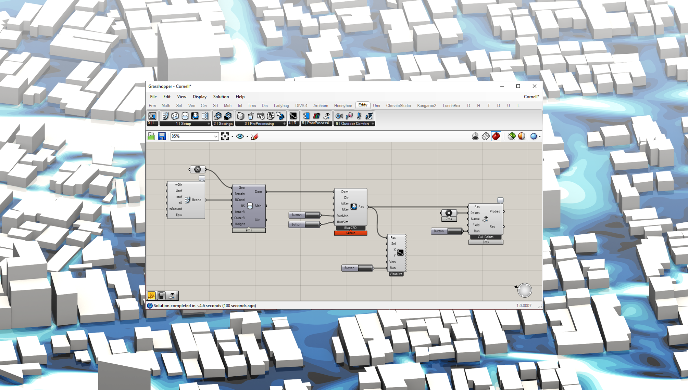{.skip-lightbox}

  [Get Started :material-arrow-right:](https://docs.eddy3d.com/){ .md-button .md-button--primary aria-label="Get Started with Eddy3D Documentation" }
  [Download :material-download:](download.md){ .md-button aria-label="Download Eddy3D" }

  Latest stable release and pre-release builds are listed on the <a href="download" aria-label="Go to the download page for Eddy3D releases">download page</a>.

---

## What you can simulate
Each card opens a ready-to-run Grasshopper template in the [template gallery](https://templates.eddy3d.com); the same templates load from the Templates component inside Grasshopper.

-   [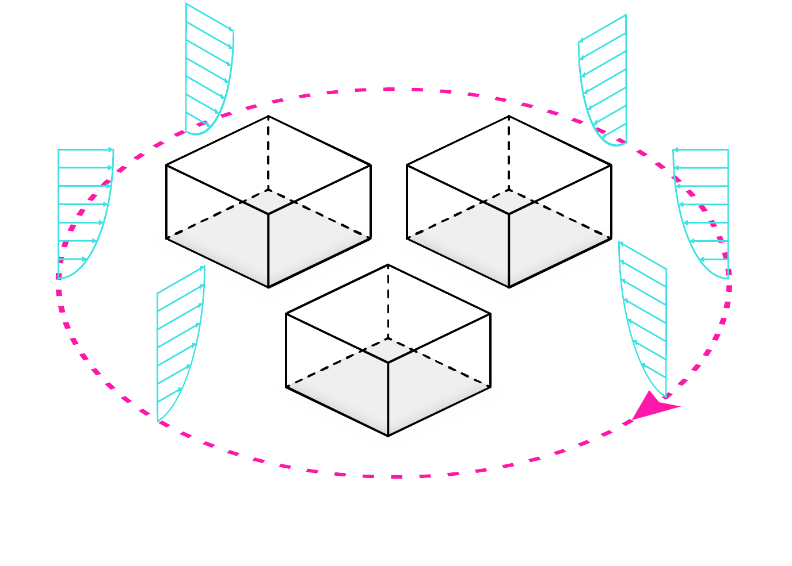{ loading=lazy .skip-lightbox }](https://templates.eddy3d.com/#t-wind-openfoam-boxdomain)

    **Wind around buildings**

    Steady RANS in OpenFOAM: wind speed and pedestrian comfort around buildings, trees and terrain.

-   [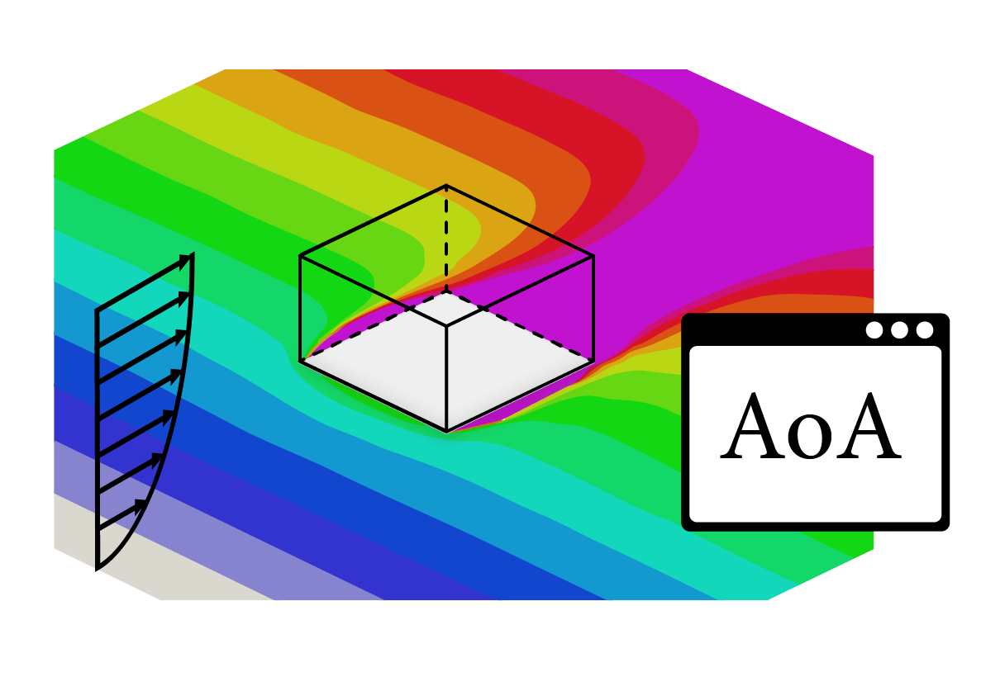{ loading=lazy .skip-lightbox }](https://templates.eddy3d.com/#t-microclimate-umf-utci)

    **Outdoor thermal comfort**

    UTCI from a fully coupled microclimate simulation with urbanMicroclimateFoam.

-   [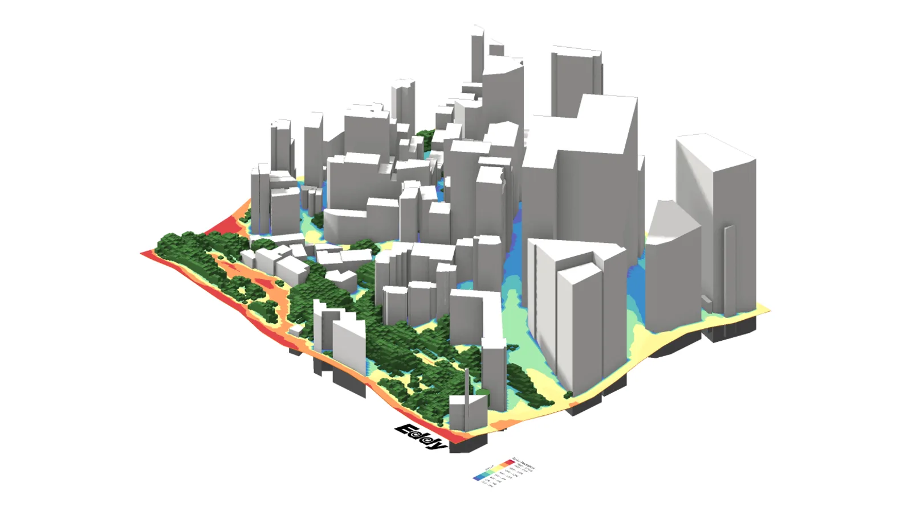{ loading=lazy .skip-lightbox }](https://templates.eddy3d.com/#t-sun-solar-radiation)

    **Sun and solar radiation**

    Annual irradiation on ground and facades, sun hours and BRE sunlight checks.

-   [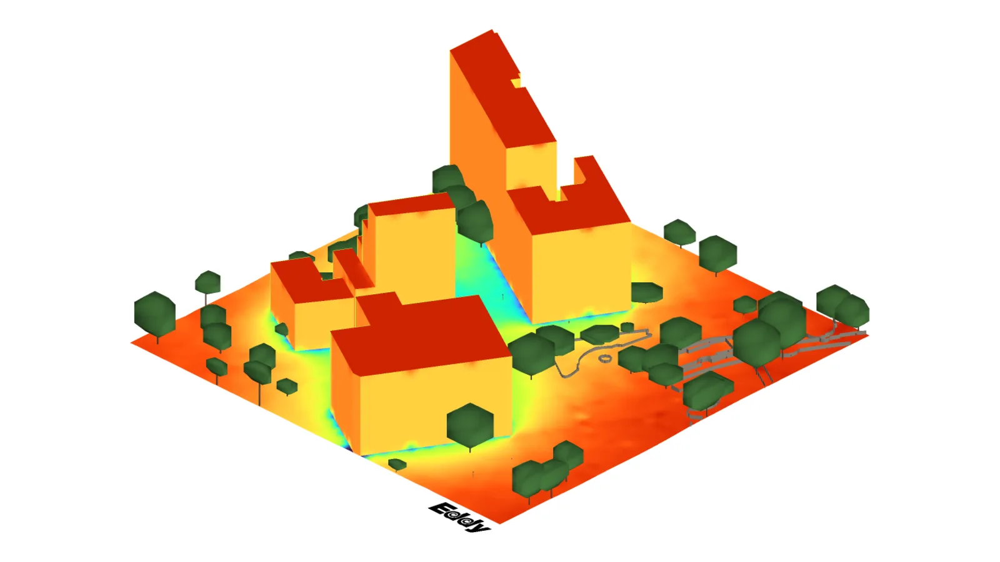{ loading=lazy .skip-lightbox }](https://templates.eddy3d.com/#t-microclimate-mrt-surfacetemps-fft)

    **Surface and radiant temperature**

    Surface temperatures of ground and walls, the input to mean radiant temperature.

-   [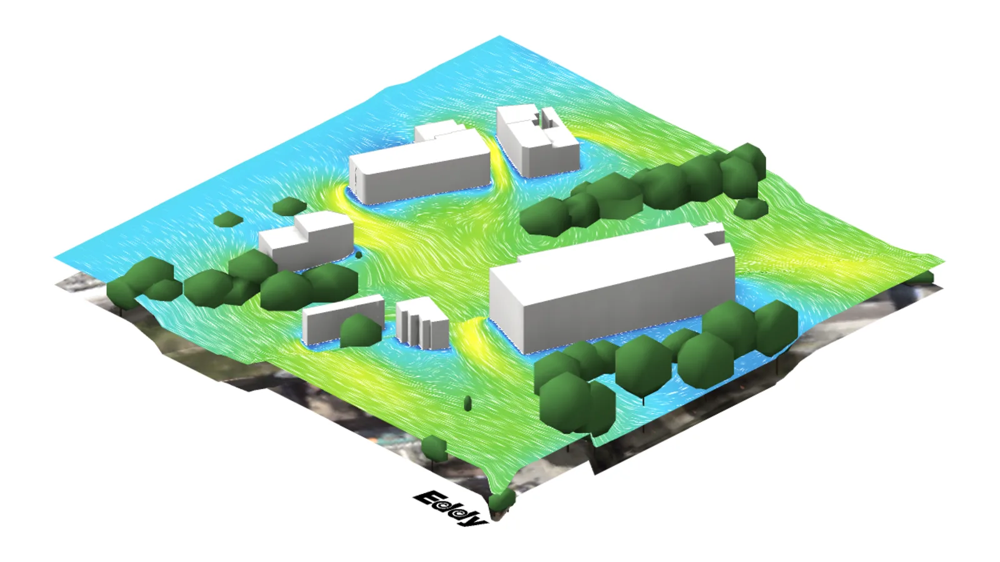{ loading=lazy .skip-lightbox }](https://templates.eddy3d.com/#t-wind-lbm-livetunnel2d)

    **Live wind tunnel**

    GPU lattice-Boltzmann wind that updates while you move the geometry.

-   [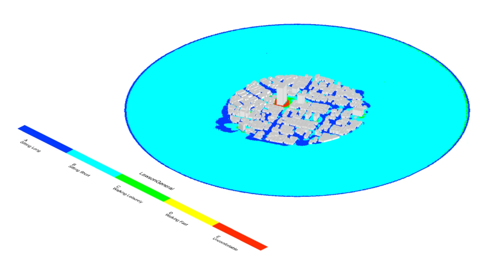{ loading=lazy .skip-lightbox }](https://templates.eddy3d.com/#t-wind-ml-ml-inference-comfort)

    **Wind comfort without CFD**

    Year-round pedestrian wind comfort classes from a trained model, in seconds.

-   [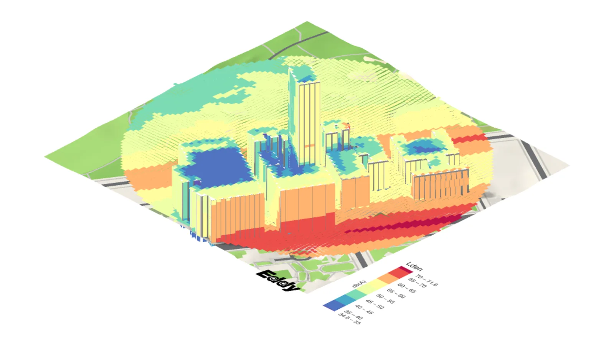{ loading=lazy .skip-lightbox }](https://templates.eddy3d.com/#t-noise-noise)

    **Road traffic noise**

    CNOSSOS-EU Lden on the ground and on every facade storey.

-   [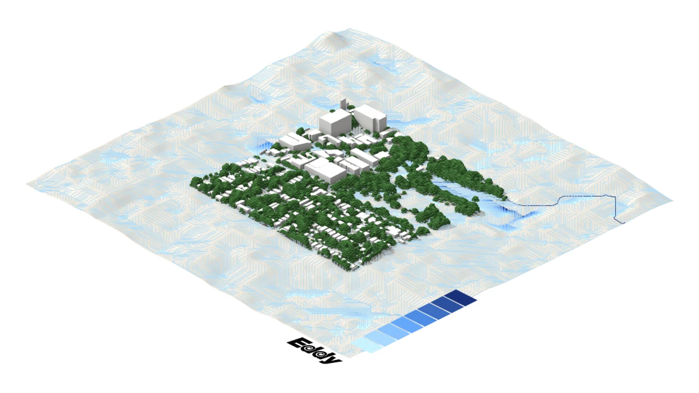{ loading=lazy .skip-lightbox }](https://templates.eddy3d.com/#t-water-stormwater)

    **Stormwater**

    Where water ponds on a graded site, and which way it runs.

Weather files and climate charts for about 16,000 stations are at [climate.eddy3d.com](https://climate.eddy3d.com). AI agents can query them over MCP at `https://climate.eddy3d.com/mcp`: see [how to connect](https://docs.eddy3d.com/latest/mcp/).

---

## Team

<figure class="mdx-users__testimonial black-and-white">
    
    <figcaption class="md-typeset">Patrick Kastner</figcaption>
  </figure>

<figure class="mdx-users__testimonial black-and-white">
    
    <figcaption class="md-typeset">İlker Karadağ</figcaption>
  </figure>

<figure class="mdx-users__testimonial black-and-white">
    
    <figcaption class="md-typeset">Sina Rahimi</figcaption>
  </figure>
  
  <figure class="mdx-users__testimonial black-and-white">
    
    <figcaption class="md-typeset">Gonzalo Vegas</figcaption>
  </figure>
  
   <figure class="mdx-users__testimonial black-and-white">
    
    <figcaption class="md-typeset">Marcelo Álvarez</figcaption>
  </figure>

<figure class="mdx-users__testimonial black-and-white">
    
    <figcaption class="md-typeset">Timur Dogan</figcaption>
  </figure>

## Advisors & Alumni

<figure class="mdx-users__testimonial black-and-white">
    
    <figcaption class="md-typeset">Tobias Holzmann</figcaption>
  </figure>
 
<figure class="mdx-users__testimonial black-and-white">
    
    <figcaption class="md-typeset">Remy Mermelstein</figcaption>
  </figure>

<figure class="mdx-users__testimonial black-and-white">
    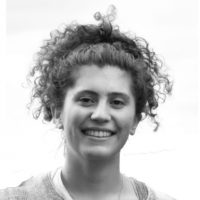
    <figcaption class="md-typeset">Zoe De Simone</figcaption>
  </figure>

---

{width="350" .skip-lightbox align=left loading=lazy}
{width="320" .skip-lightbox align=right loading=lazy}

:octicons-plus-24:{ aria-hidden="true" }

   

Eddy3D is being developed as a cross-disciplinary project through a collaboration between the Georgia Tech School of Architecture, the Environmental Systems Lab at Cornell AAP, and the Systems Engineering department at Cornell Engineering.

---

## Supporters

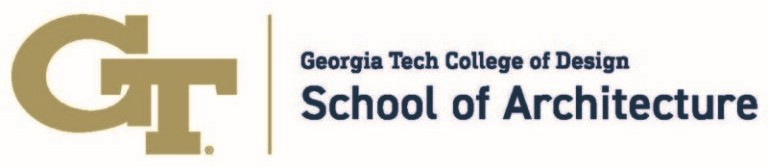{width="250" .skip-lightbox loading=lazy .center}
{ .card }

{width="250" .skip-lightbox loading=lazy .center}
{ .card }

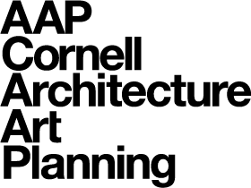{width="75" .skip-lightbox loading=lazy .center}
{ .card }

{width="75" .skip-lightbox loading=lazy .center}
{ .card }

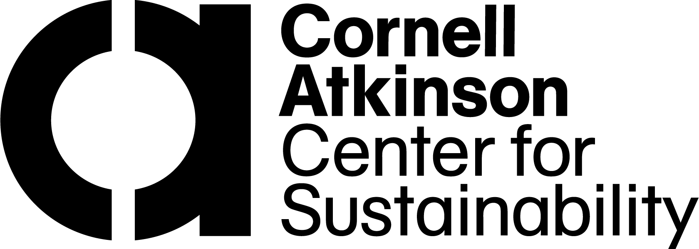{width="200" .skip-lightbox loading=lazy .center}
{ .card }

{width="250" .skip-lightbox loading=lazy .center}
{ .card }

